# Cisco Network Lab (Hands-on Practice)

A hands-on lab built on real hardware that covers inter-VLAN routing (Router-on-a-Stick), NAT overload, DHCP, and ACL-based access control between departments.

**Designed and implemented by Chanathip Artwichian**

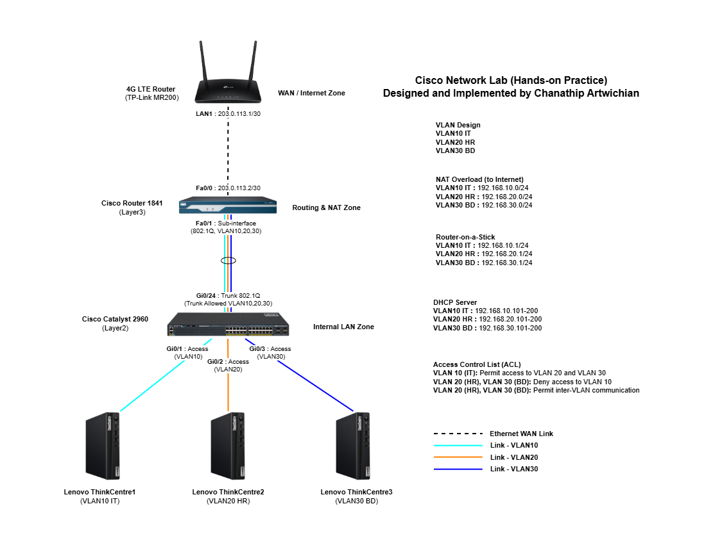

---

## Table of Contents

1. [Objectives](#objectives)
2. [Equipment](#equipment)
3. [Topology](#topology)
4. [Addressing Plan](#addressing-plan)
5. [Configuration Summary](#configuration-summary)
6. [Verification and Test Results](#verification-and-test-results)
7. [Repository Structure](#repository-structure)
8. [Key Takeaways](#key-takeaways)

---

## Objectives

- Segment a small office network into three VLANs (IT, HR, BD)
- Route between VLANs using a router with 802.1Q sub-interfaces (Router-on-a-Stick)
- Provide DHCP services for each VLAN from the router
- Give all VLANs internet access through NAT overload (PAT)
- Enforce a department access policy with extended ACLs

## Equipment

| Role | Device | Notes |
|---|---|---|
| Internet gateway | TP-Link Archer MR200 | WAN side of the lab |
| Router (Layer 3) | Cisco 1841 | Fa0/0 = WAN, Fa0/1 = trunk with sub-interfaces |
| Switch (Layer 2) | Cisco Catalyst 2960 | Gi0/24 = trunk, Gi0/1-3 = access ports |
| Clients | Lenovo ThinkCentre x 3 | One per VLAN |

## Addressing Plan

### WAN

| Device | Interface | Address |
|---|---|---|
| TP-Link Archer MR200 | WAN1 | 203.0.113.1/30 |
| Cisco 1841 | Fa0/0 | 203.0.113.2/30 |

### VLANs

| VLAN | Name | Subnet | Default Gateway (Router sub-interface) | DHCP Pool | Switch Port |
|---|---|---|---|---|---|
| 10 | IT | 192.168.10.0/24 | 192.168.10.1 | 192.168.10.101 - .200 | Gi0/1 |
| 20 | HR | 192.168.20.0/24 | 192.168.20.1 | 192.168.20.101 - .200 | Gi0/2 |
| 30 | BD | 192.168.30.0/24 | 192.168.30.1 | 192.168.30.101 - .200 | Gi0/3 |

### Trunk

| Device | Port | Mode | Allowed VLANs |
|---|---|---|---|
| Catalyst 2960 | Gi0/24 | 802.1Q trunk | 10, 20, 30 |
| Cisco 1841 | Fa0/1 | 802.1Q sub-interfaces | 10, 20, 30 |

## Configuration Summary

Full device configurations are in the [`03-configs/`](03-configs/) folder (sensitive values have been redacted).

| Feature | Implementation |
|---|---|
| VLANs | VLAN 10 (IT), VLAN 20 (HR), VLAN 30 (BD) on the 2960 |
| Inter-VLAN routing | Router-on-a-Stick: `Fa0/1.10`, `Fa0/1.20`, `Fa0/1.30` using `encapsulation dot1Q` |
| DHCP | One pool per VLAN on the router (range .101 - .200) |
| NAT | NAT overload (PAT) for 192.168.10.0/24, 192.168.20.0/24, 192.168.30.0/24 out through Fa0/0 |
| Default route | Static default route to 203.0.113.1 |
| ACL | Department access policy (see below) |

### Access Policy (ACL)

| Source | Destination | Result |
|---|---|---|
| VLAN 10 (IT) | VLAN 20 (HR), VLAN 30 (BD) | Permit |
| VLAN 20 (HR) | VLAN 10 (IT) | Deny |
| VLAN 30 (BD) | VLAN 10 (IT) | Deny |
| VLAN 20 (HR) | VLAN 30 (BD) | Permit |
| VLAN 30 (BD) | VLAN 20 (HR) | Permit |
| All VLANs | Internet | Permit (via NAT) |

In short, IT can reach every department, HR and BD can communicate with each other, and neither HR nor BD can initiate connections to IT.

## Verification and Test Results

### Switch (Catalyst 2960)

**VLANs and port assignments** (`show vlan brief`)

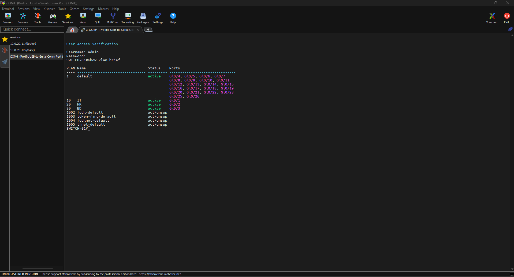

**Trunk status** (`show interfaces trunk`)

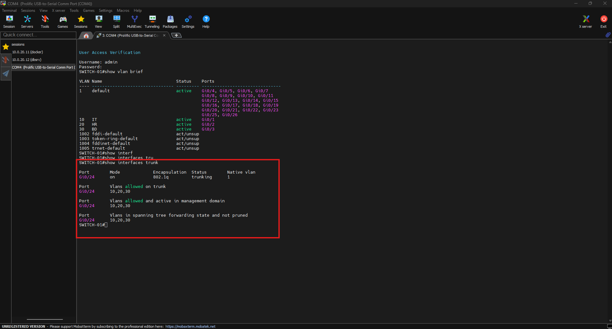

### Router (Cisco 1841)

**Interface status** (`show ip interface brief`)

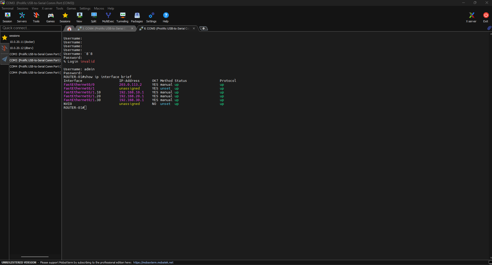

**Routing table** (`show ip route`)

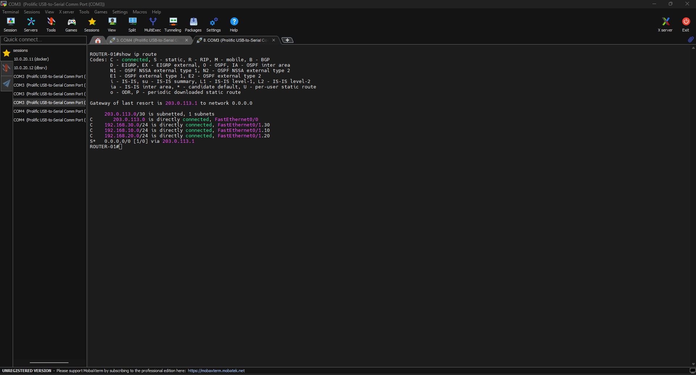

**DHCP pools** (`show ip dhcp pool`)

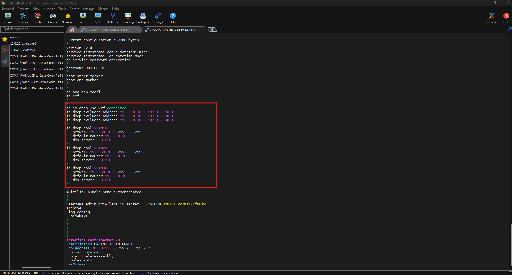

**DHCP leases** (`show ip dhcp binding`)

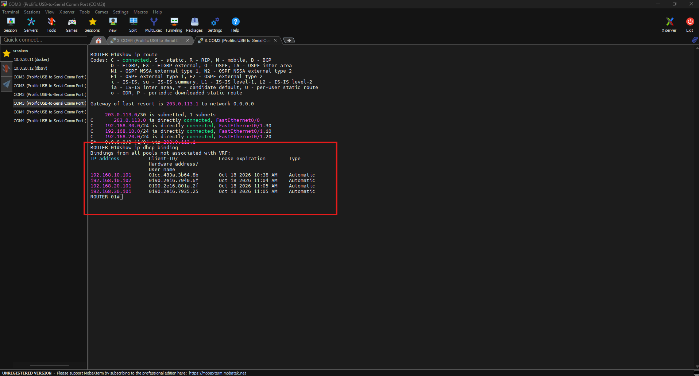

### Clients

| VLAN | IP configuration |
|---|---|
| VLAN 10 (IT) | 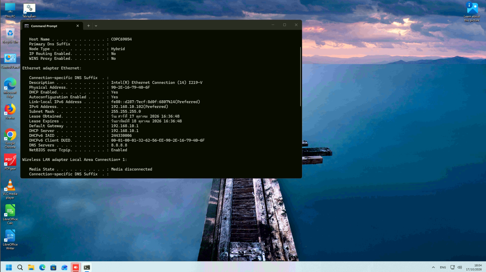 |
| VLAN 20 (HR) | 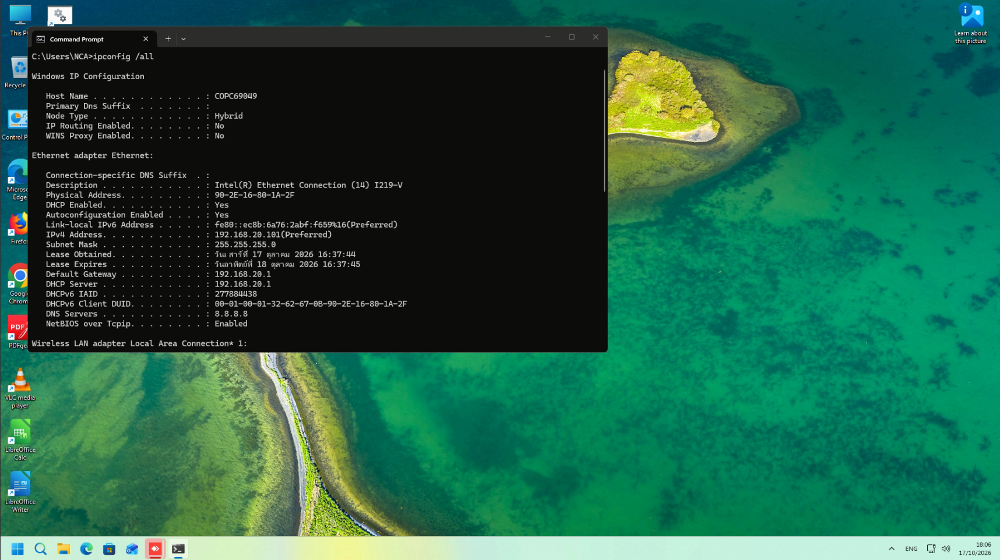 |
| VLAN 30 (BD) | 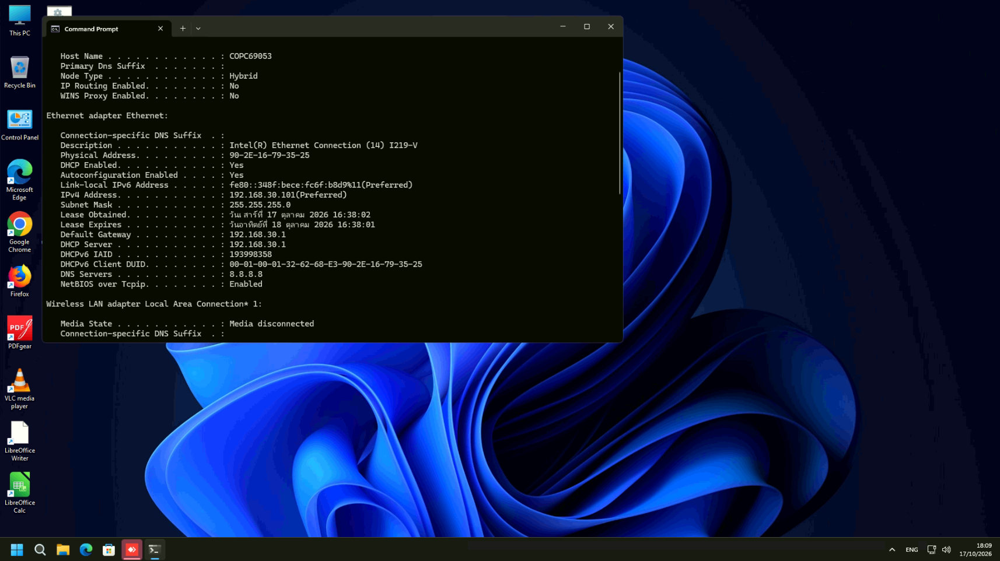 |

### Internet Access and NAT

**Internet connectivity from each VLAN** (`ping 8.8.8.8` and `ping google.com`)

| VLAN | Result |
|---|---|
| VLAN 10 (IT) | 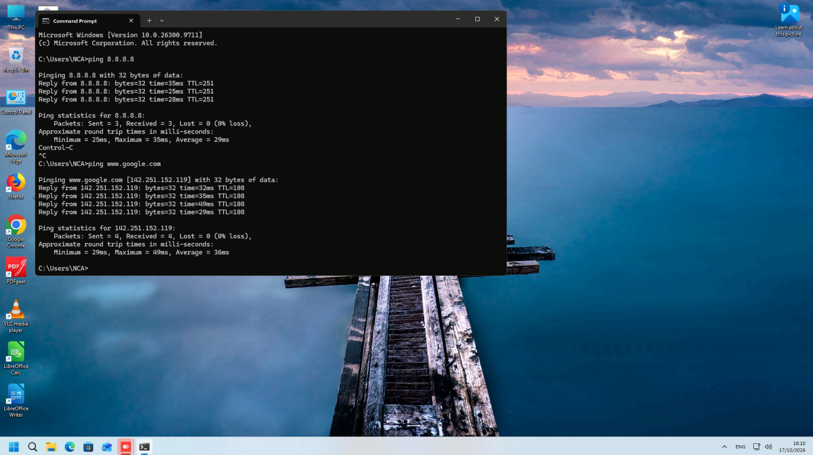 |
| VLAN 20 (HR) | 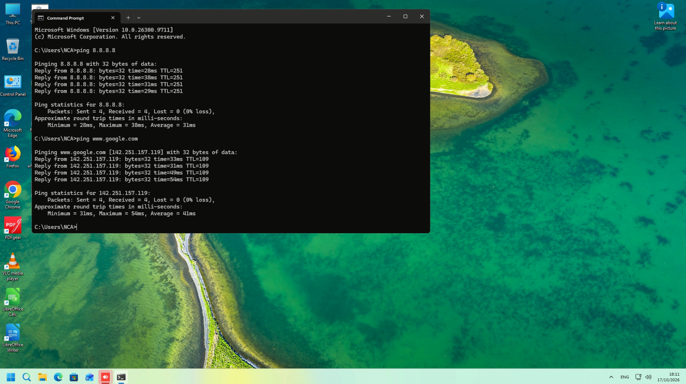 |
| VLAN 30 (BD) | 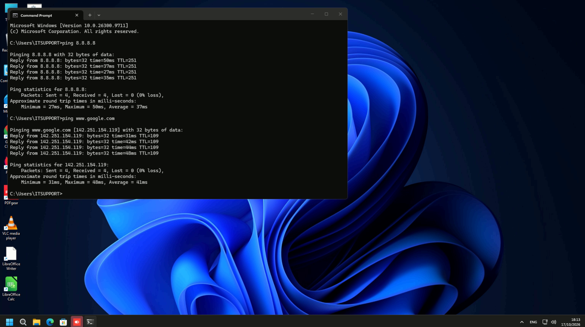 |

**NAT translations** (`show ip nat translations`)

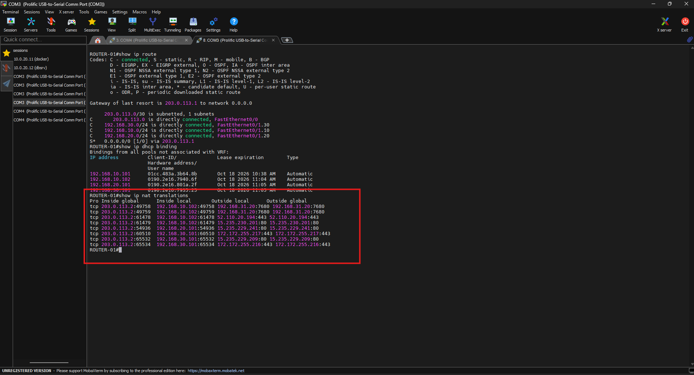

### ACL Tests

| Test | Expected | Result |
|---|---|---|
| VLAN 10 to VLAN 20 / VLAN 30 | Success | 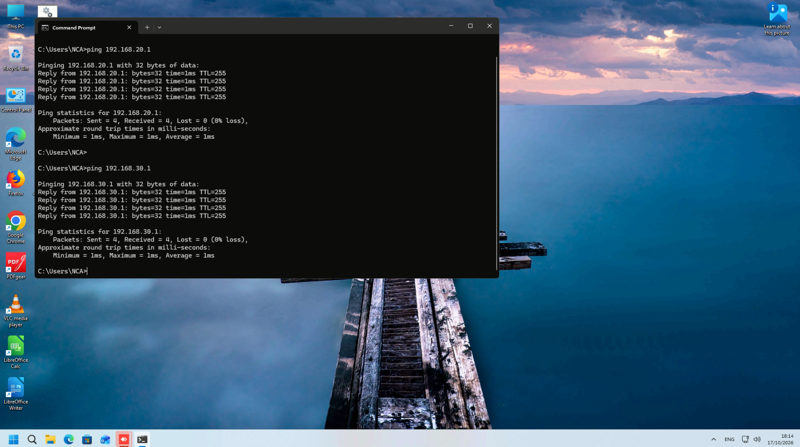 |
| VLAN 20 to VLAN 30 | Success | 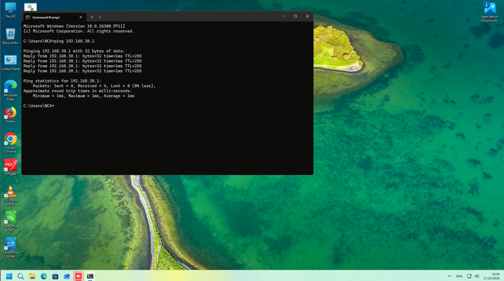 |
| VLAN 20 to VLAN 10 | Blocked | 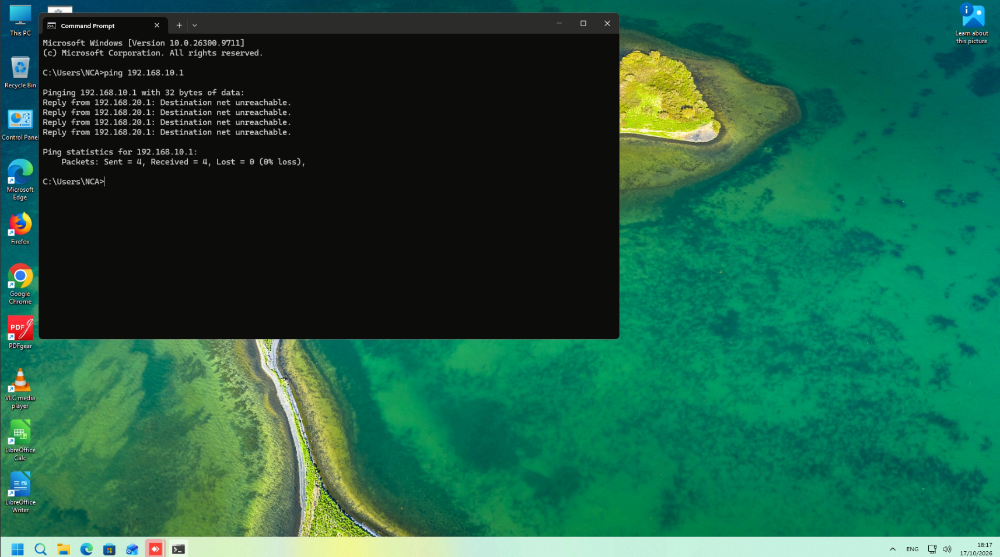 |
| VLAN 30 to VLAN 10 | Blocked | 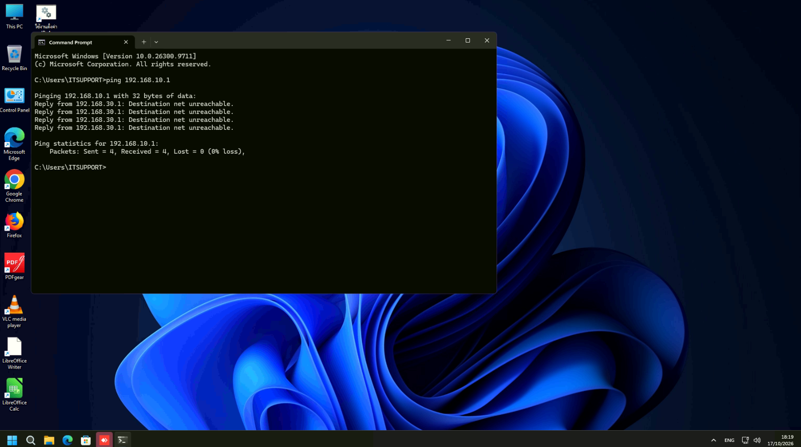 |

**ACL hit counters** (`show access-lists`)

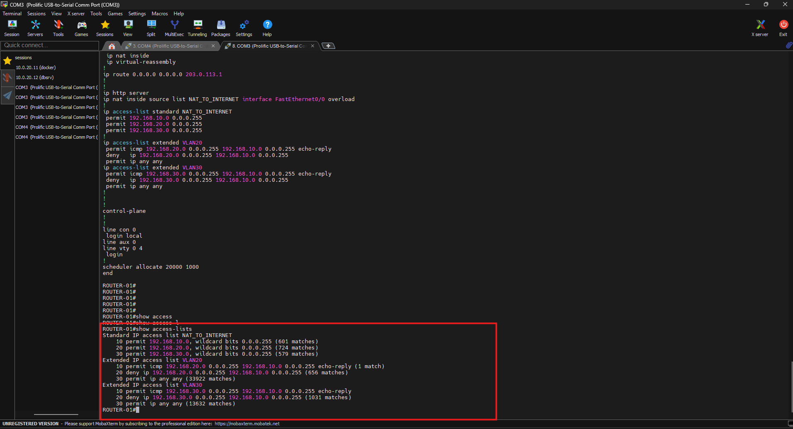

## Repository Structure

```
cisco-network-lab/
├── README.md
├── 01-diagrams/        # Network diagram
├── 02-screenshots/     # Command output and test results
└── 03-configs/         # Device configurations (sensitive data redacted)
```


## Author

**Chanathip Artwichian**
GitHub: [@chanathip-awc](https://github.com/chanathip-awc)
